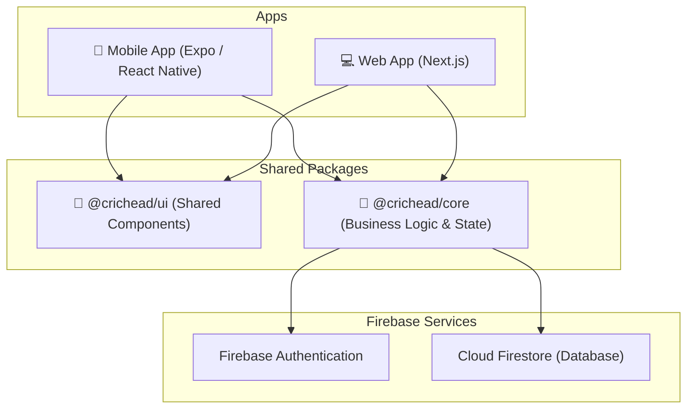

# Crichead: System Design & Architecture Overview

## Executive Summary
**Crichead** is a cross-platform cricket scoring and management application built using a **Monorepo Architecture** powered by Turborepo. The system separates its core business logic, shared UI components, and platform-specific applications (Mobile and Web) into distinct packages and apps.

## High-Level Architecture

## System Components

### 1. Monorepo Structure (Turborepo)
The project is structured as a single monorepo to maximize code sharing and maintain consistency across clients.
- **`apps/mobile`**: The iOS and Android mobile application.
- **`apps/web`**: The web-based dashboard or client interface.
- **`packages/core`**: The central brain of the application.
- **`packages/ui`**: A centralized design system and shared component library.

### 2. Frontend Applications

#### Mobile App (`apps/mobile`)
- **Framework**: React Native with **Expo**.
- **Navigation**: Uses **Expo Router** for file-based routing (e.g., `(tabs)`, `match` routes).
- **Responsibilities**: Provides the primary, on-the-go interface for users to score matches locally, view live matches, and interact with device hardware (e.g., haptics).

#### Web App (`apps/web`)
- **Framework**: **Next.js** (React).
- **Styling**: Tailwind CSS.
- **Responsibilities**: Likely serves as an administrative dashboard, web-based viewer for live scores, or a portal for users who prefer desktop access. It can leverage Next.js API routes with Firebase Admin for secure server-side operations.

### 3. Shared Packages

#### Core Logic (`packages/core`)
This package encapsulates all non-visual business logic, making the apps effectively "thin clients". It follows a strict **Layered Architecture** to enforce separation of concerns and maximize testability:

- **Domain Layer (`src/domain`)**: Contains pure business logic, interfaces, schemas (via **Zod**), and the headless scoring engine (`src/domain/scoring`). This layer has zero dependencies on external libraries or infrastructure.
- **Application Layer (`src/application`)**: Orchestrates the domain logic. Contains the global **Zustand** store (`src/application/store`) and application-specific semantic actions (`src/application/actions`).
- **Infrastructure Layer (`src/infrastructure`)**: Implements external services, primarily the Firebase App and Admin SDK abstractions (`src/infrastructure/firebase`) used for realtime database subscriptions and backend functions.
- **Presentation Layer (`src/presentation`)**: Contains custom React Native/React hooks (`src/presentation/hooks` like `useScoringEngine` and `useMatchSync`) that bridge the core store and infrastructure to the UI components.
- **Shared (`src/shared`)**: General utilities and design tokens (`tokens.ts`) used across layers.

#### Shared UI (`packages/ui`)
- Contains cross-platform UI components. While the exact primitive depends on the implementation (e.g., React Native Web or separate component trees), this ensures a consistent look and feel (colors, typography via `tokens.ts`) across Mobile and Web.

### 4. Backend (Firebase)
- **Database (Firestore)**: A NoSQL document database. Stores structured data like `MatchDoc`, `Team`, and `Player` profiles. It is highly optimized for realtime subscriptions, allowing live updates to flow seamlessly to connected clients.
- **Authentication**: Firebase Auth handles user identities securely.

## Key Design Patterns

1. **Headless Architecture & "Thin" Clients**
   By pulling the `useScoringState` and scoring engine out of the React Native app and into `@crichead/core`, the business logic can be independently unit-tested (via Vitest) and immediately reused on the Next.js web platform without rewriting code.

2. **Event-Driven Scoring Updates**
   Cricket scoring is complex (undo actions, extras, wickets). The scoring engine uses an event-stream approach, parsing sequential match events to derive the current state, ensuring determinism and easier local-to-live syncing.

3. **Strict Typings & Schemas**
   End-to-end type safety mapping TypeScript interfaces to Zod schemas. This ensures that a `FirestoreMatchDoc` conforms exactly to the app's expectations, preventing runtime `undefined` errors.

4. **Layered Architecture in `@crichead/core`**
   The core package is structured into Domain (pure logic), Application (state), Infrastructure (Firebase), and Presentation (React hooks) layers. This strictly unidirectional dependency graph ensures that core cricket scoring rules (Domain) can be unit-tested in isolation without mocking a database or UI framework.
